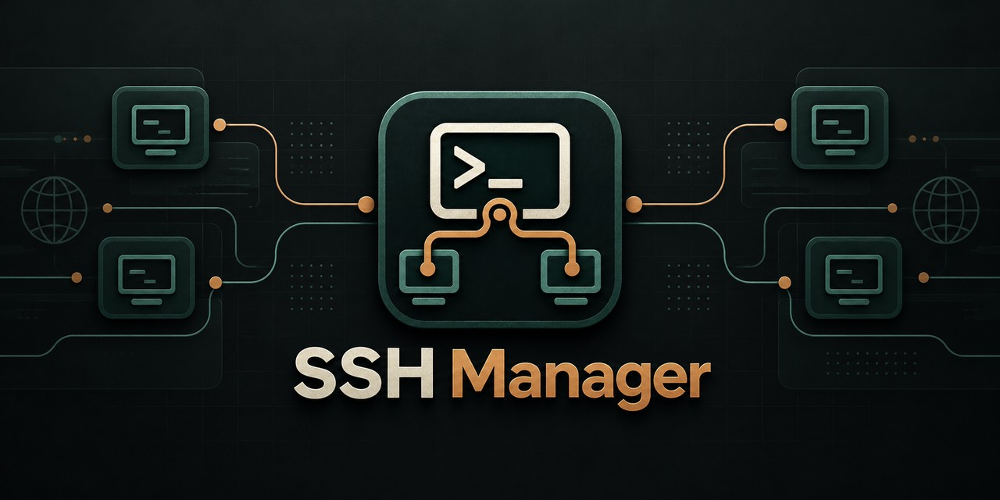
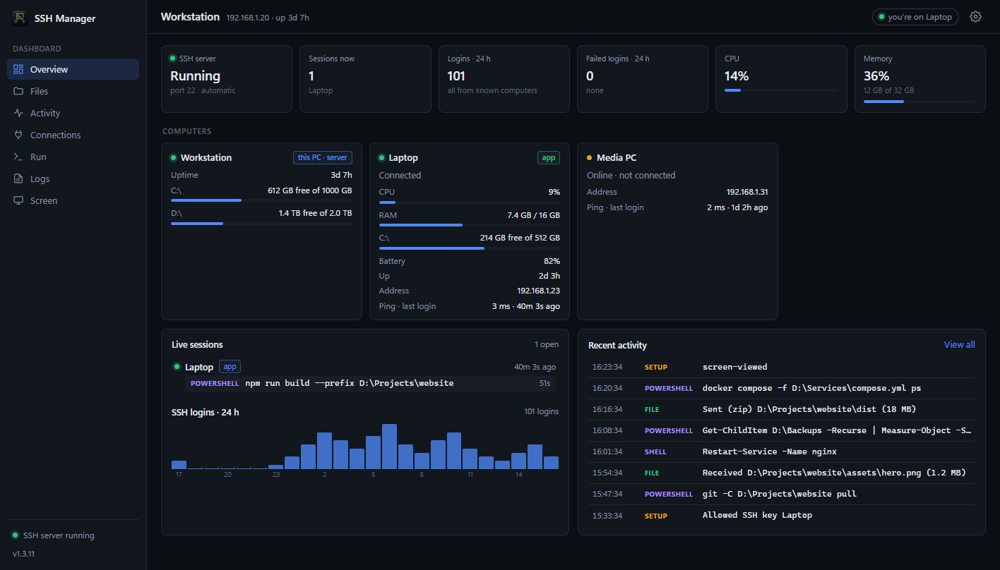

<p align="center">
  
</p>

<h3 align="center">One app to see and manage all your Windows PCs over SSH</h3>

<p align="center">
  Live status, sessions and activity, drag-and-drop file transfer, remote commands, logs, screen preview,
  folder sync and Wake-on-LAN. Self-hosted, no cloud service and no accounts: it runs on Windows' built-in OpenSSH.
</p>

<p align="center">
  <a href="https://github.com/Sandiozo/ssh-manager/releases/latest"></a>
  <a href="https://github.com/Sandiozo/ssh-manager/releases"></a>
  
  <a href="LICENSE"></a>
</p>

<p align="center">
  <a href="https://github.com/Sandiozo/ssh-manager/releases/latest/download/SSHManager-Setup.exe"><b>⬇ Download for Windows</b></a>
  &nbsp;·&nbsp; <a href="#quick-start">Quick start</a>
  &nbsp;·&nbsp; <a href="#features">Features</a>
  &nbsp;·&nbsp; <a href="#security">Security</a>
  &nbsp;·&nbsp; <a href="#faq">FAQ</a>
  &nbsp;·&nbsp; <a href="CHANGELOG.md">Changelog</a>
</p>

<p align="center">
  
</p>

## Why SSH Manager

You work on one computer but run things on others: a home server, a gaming or build PC, a machine your
scripts or AI tools reach over SSH. SSH Manager shows what is happening there (who is connected, what they
ran, how the machine is doing) and lets you move files, run commands, follow logs and glance at the screen
without opening a remote desktop.

- **Nothing to sign up for.** No cloud relay, no account, no telemetry. Your PCs talk to each other directly.
- **Built on what Windows already has.** It uses the OpenSSH Server that ships with Windows and sets it up
  for you.
- **Safe by design.** Each PC's server only listens on `127.0.0.1` and is reached through an SSH tunnel, so
  using a PC's dashboard always requires an SSH login to that PC.
- **One installer for every PC.** Pick what each PC should do; dependencies are installed for you and
  updates install themselves.

## Quick start

1. Download **[SSHManager-Setup.exe](https://github.com/Sandiozo/ssh-manager/releases/latest/download/SSHManager-Setup.exe)**
   and run it on every PC you want to use.
2. Choose **Client and server** on PCs you want to manage (a desktop, a home server) and **Client** on PCs
   you only work from (a laptop).
3. Open SSH Manager, click **+ Add PC**, pick the PC from **Search my network** and allow this computer
   once. That's it.

> Windows may show "Windows protected your PC" because the installer isn't code-signed. Click
> **More info → Run anyway**. Each release lists the installer's SHA-256 checksum.

## Install

**Requirements:** Windows 10 (version 1809 or later) or Windows 11, 64-bit. Everything else is installed
for you: the .NET Desktop Runtime and WebView2 if they are missing, and OpenSSH Server for the server role.
No Python needed.

The installer asks what the PC should do:

| Role | What it installs |
|---|---|
| **Client** | The app, to see and manage your other PCs from this one. |
| **Client and server** | The app, plus everything needed for other PCs to manage this one: it turns on Windows' OpenSSH Server, allows it through the firewall on private networks, and runs SSH Manager's server in the background (started at sign-in). |

The page shows what is installed already and what will be downloaded. Run the installer again at any time
to switch roles.

### Adding a PC

In the app, click **+ Add PC** and enter the PC's name or IP address, or use **Search my network**. The app
creates a key for this computer and signs in with it. If one of your keys already works (in `~/.ssh` or a
host from `~/.ssh/config`), the PC is added straight away. Otherwise you allow this computer on that PC
once, in one of three ways:

| Method | When to use it |
|---|---|
| **Approve on the other PC** | The other PC's SSH Manager app is connected to this PC. Send a request and click **Allow** there. The prompt shows who is asking and the key's fingerprint, and expires after two minutes. No password needed. |
| **Sign in with a password** | First connection between two PCs. Use the Windows password of your account on that PC (for a Microsoft account: the account password, not the PIN). It is used once and never stored. |
| **Copy the key** | The other PC only allows PIN / Windows Hello sign-in. Copy this computer's public key and paste it on the other PC under Settings → SSH keys → **Allow a new key**. |

Each PC decides for itself who may manage it: adding PC B on PC A never lets B manage A.

## Features

**Monitor**

- **All PCs:** totals over the last 24 hours (logins, failed logins, commands, data transferred), SSH
  logins per hour for each PC, everyone connected anywhere, and one activity timeline across all PCs that
  you can filter by PC, type or text. Below that, a card per PC with CPU, RAM, disks and failed logins.
- **Live sessions:** who is connected over SSH and the command each session is running right now.
- **Activity log:** every command run over SSH with the full script (`powershell -EncodedCommand` scripts
  are decoded), every file transfer, run and settings change, labelled with the computer that did it.
- **Connections:** login and logout history and failed login attempts from the OpenSSH event log.

**Manage**

- **Files:** browse a PC; drop files or folders anywhere in the window to send them, drag files out to
  download, folders come as zip; rename, delete (to the Recycle Bin) and folder shortcuts. A transfer panel
  shows progress, speed and time left.
- **Run:** one-click quick actions (PowerShell scripts you save, grouped, optionally asking before they run)
  and a command panel for anything else. Output streams live and runs can be stopped.
- **Logs:** follow any log file live, like `tail -f`: a file, the newest file in a folder, or the newest
  match of a pattern such as `C:\Logs\app-*.log`. Filter lines as you type.
- **Screen:** a view-only live preview of a monitor or of a single app window (even when other windows
  cover it), refreshed every 1 to 10 seconds. Each PC decides what may be viewed: everything, only
  single app windows, only a list of apps, or nothing. Every viewing is logged.

**Connect**

- **Folder sync:** keep a folder on this computer and a folder on a PC the same, in one direction or both.
  Changes are sent a few seconds after they happen. Sync never deletes files; `.git`, `node_modules` and
  the like are skipped by default.
- **Shared clipboard:** text copied on one computer can be pasted on the others (off until you switch it
  on in the app settings).
- **Wake-on-LAN:** wake a PC that is asleep or off from its card. The app learns each PC's network card
  while connected; the PC needs Wake-on-LAN enabled in its BIOS and network adapter settings.

**Everyday**

- **Tray app:** keeps every connection open and reconnects by itself (by computer name, falling back to the
  last known address), and notifies about lost connections, failed logins, unknown computers and finished
  transfers.
- **Settings** (⚙ in the top bar): the computers that connect, the SSH keys allowed to log in, quick
  actions, logs, file shortcuts, screen preview, updates and the app's own options.
- **Automatic updates:** each PC updates itself when a new release is published; downloads are checked
  against their SHA-256.
- **Plugins:** small Python files that add your own command decoders, activity details or API routes.
- **Command line:** `sshmgr` lets scripts and AI agents run commands, move files, take screenshots and
  wait for things on your PCs through the app's connections (see [Command line](#command-line)).

## Command line

The app comes with `sshmgr`, a command-line tool for scripts and AI agents. It uses the PCs the app is
connected to, through the app's own connections: no SSH setup, port forward or access token of its own.
It asks the running app for a PC's connection over a local pipe that only your Windows account can open,
and nothing is stored on disk. The installer adds it to `PATH` (open a new terminal after installing).

```
sshmgr pcs                                          the PCs in the app and whether they are connected
sshmgr run <pc> "Get-Service sshd" [--cwd <dir>] [--env K=V] [--timeout <s>]
sshmgr run <pc> -f script.ps1                       a script file (- reads it from standard input)
sshmgr actions <pc>    /  sshmgr action <pc> <id>   list and run quick actions
sshmgr shot <pc> screen.png [--window <app>|--monitor <n>]
sshmgr windows <pc>                                 app windows that can be captured
sshmgr get <pc> "C:\Logs\app.log" .\               download (a folder comes as a zip)
sshmgr put <pc> .\build.zip "C:\Deploy\" [--overwrite]
sshmgr wait <pc> --file "C:\out\done.txt" [--changed-after now] [--timeout <s>]
sshmgr wait <pc> --process setup [--exited] [--timeout <s>]
```

`<pc>` is a PC's name, the name or address it was added with, or its id. `run` and `action` stream the
output as it comes and exit with the script's exit code; Ctrl+C stops the run on the PC. Other exit codes:
1 failed (or `wait` timed out), 2 wrong usage, 3 the app isn't running or the PC isn't connected. `pcs`,
`actions`, `windows` and `wait` take `--json`. Screenshots are full size; a `.png` is lossless. Everything
it does is in that PC's activity log, like anything else done from the app. Run `sshmgr help` for all
options.

## Automation API

Scripts and AI agents can use the same API as the dashboard (`sshmgr` above is the easy way to). It is
only reachable on `127.0.0.1` of each PC, so open an SSH port forward first (`ssh -L 18765:127.0.0.1:8765 <pc>`). Read the access token
once over SSH with `"C:\Program Files\SSH Manager\Server\SSHManagerServer.exe" --client-info` (the
`SSHMGR-TOKEN:` line) and send it with every request as the `X-SSHMgr-Token` header; requests that
change something also need `X-SSHMgr: 1`. Everything done through the API is in the activity log.

| Call | What it does |
|---|---|
| `POST /api/run` `{script, title?, cwd?, env?}` | Runs a PowerShell script (admin, in the signed-in user's session). `cwd` may use environment variables; `env` adds variables for this run; titles over 200 characters are shortened. |
| `GET /api/runs/{id}?after=N` | Status, exit code and the output lines after line `N` (count from the start of the run; `next` is the value for the following call). Only the last 5,000 lines are kept here; `skipped` tells how many were left out. |
| `GET /api/runs/{id}/output` | The complete output as a text file (for the last 50 runs). |
| `POST /api/runs/{id}/stop` | Stops a run. |
| `GET /api/actions`, `POST /api/actions/{id}/run` | Lists and runs quick actions. |
| `GET /api/screen/windows` | Open app windows (`id`, `app`, `title`), limited to the allowed apps. |
| `GET /api/screen?window=ID` or `?monitor=N` | A screenshot. `format=png` is lossless; `width=0` keeps the full size; `quality` (JPEG) goes up to 100. |
| `GET /api/wait?file=PATH[&changed_after=now]` | Waits until a file exists (and changed after a time: ISO, Unix seconds or `now`). |
| `GET /api/wait?process=NAME&state=started\|exited` | Waits until a program has started or exited. Both forms take `timeout` (seconds, up to 300) and answer `{"met": true/false, ...}`. |
| `GET /api/fs/download?path=…`, `PUT /api/fs/upload?path=…&overwrite=1` | Downloads a file (several paths or a folder come as a zip) and uploads one (the request body is the file). |

## How it works

```
 the PC you work on                               a PC you manage
┌──────────────────────────┐   SSH (port 22)   ┌──────────────────────────────┐
│ SSH Manager app          │ ═════════════════►│ OpenSSH Server               │
│  one port forward per PC │                   │   └ SSH Manager server       │
│  localhost:87xx ─────────┼───────────────────┼──► 127.0.0.1:8765            │
└──────────────────────────┘                   └──────────────────────────────┘
```

The server on each PC only listens on `127.0.0.1`. The app reaches it through an SSH port forward, so no
extra port is opened and using a PC's dashboard requires being able to log in to it over SSH. The app also
reports its own computer's CPU, memory and battery to the PCs it is connected to, so they can show it too.

## Security

- The server listens on `127.0.0.1` only; reaching it from another computer requires SSH access.
- Every request needs an access token, which the app reads over SSH when it connects.
- Requests from web sites are blocked (Host header check, and a custom header is required for changes).
- The server runs with administrator rights, because Windows runs an administrator's SSH sessions elevated
  and the server needs to see them. Anyone who can use a PC's dashboard can read and write any file there,
  run commands and change which keys may log in: the same power as an SSH login to that account. Only give
  SSH access to people you would give that to.
- Quick actions and the command panel run with the server's administrator rights.
- The activity log stores full command lines, which can include secrets passed on the command line. It
  stays on that PC.
- The screen preview and shared clipboard only work while someone is signed in to that PC. In Settings
  each PC can turn the preview off, allow single app windows only, or limit it to a list of apps (other
  windows are then neither listed nor captured, also through the API). The clipboard is off until you
  switch it on.
- New host keys are accepted the first time the app connects (trust on first use) and checked after that.
- Pairing requests only carry a public key, can only be filed by someone who can already use this PC's
  dashboard, reach only apps connected to this PC, expire after two minutes and change nothing until
  someone clicks **Allow**. Every request and answer is logged on both PCs.
- Passwords typed when adding a PC are handed to `ssh` once and never stored.
- Updates are downloaded from this repository's GitHub releases and checked against their SHA-256.

Found a security problem? Please report it privately, see [SECURITY.md](SECURITY.md).

## Configuration

| | |
|---|---|
| Program | `C:\Program Files\SSH Manager` (`App`, `Cli`, `Server`, `Tools`) |
| App settings | `%LOCALAPPDATA%\SSHManager\settings.json` |
| Server settings and data ("home") | `%LOCALAPPDATA%\SSHManager\server` of the user who installed it |
| Server logs | `<home>\data\server.log`; setup log: `C:\Program Files\SSH Manager\Server\setup.log` |

To keep the server's settings somewhere else (for example in your own private repository), put the folder
path in `sshmgr-home.txt` in the `Server` folder, or set the `SSHMGR_HOME` environment variable.

```
<home>
├─ config.json   computers, key labels, file shortcuts, quick actions, logs, display name, updates, port
├─ plugins\      your plugins (*.py)
└─ data\         activity log, logs, access token, key-file backups, downloaded updates
```

Most of `config.json` can be edited under **Settings** (⚙):

| Key | Meaning |
|---|---|
| `port` | port the server listens on (127.0.0.1); default `8765` |
| `name` | display name of this PC (default: the computer name) |
| `peers` | computers that connect: `{ "name", "host", "ip" }`, used for cards and labels |
| `keys` | labels for SSH key fingerprints: `{ "SHA256:…": "Work laptop" }` |
| `bookmarks` | file shortcuts: `{ "name", "path" }` (`%USERPROFILE%` and similar work) |
| `default_upload` | where files dropped outside the Files page go (default: Desktop) |
| `actions` | quick actions: `{ "name", "group", "script", "confirm", "timeout" }` |
| `logs` | logs: `{ "name", "path" }` (a file, a folder or a pattern like `logs\app-*.log`) |
| `screen_preview` | allow other PCs to view this PC's screen (default `true`) |
| `screen_monitors` | allow whole-screen (monitor) previews; `false` allows single app windows only (default `true`) |
| `screen_apps` | program names whose windows may be listed and viewed, e.g. `["notepad", "Code"]` (default: all) |
| `auto_update` | install new releases automatically (default `true`) |

See [`config.example.json`](config.example.json) for a starting point.

## Plugins

A plugin is a `.py` file in `<home>\plugins\` with a `setup(ctx)` function, loaded when the server starts.
See [`plugins/example.py`](plugins/example.py).

```python
def setup(ctx):
    def decode(rec):                 # a command just started in an SSH session
        if "my-wrapper.ps1" in rec["script"]:
            rec["kind"] = "wrapper"  # change kind / script; the summary is recomputed
    def finished(rec):               # it ended: return extra fields for the activity entry
        return {"output": "..."}
    ctx.add_decoder(decode)
    ctx.on_command_finished(finished)
    # ctx.app is the FastAPI app (add routes), ctx.config, ctx.home, ctx.monitor, ctx.activity
```

Plugins run inside the server with its administrator rights, so only use plugins you trust.

## Extras

**HiddenRun** (`C:\Program Files\SSH Manager\Tools\HiddenRun.exe` on PCs that can be managed) runs a
program with no window. Scheduled tasks that start `powershell -WindowStyle Hidden` still flash a console;
use `HiddenRun.exe powershell.exe -File script.ps1` as the task's action instead.

## FAQ

**Is it free?** Yes. SSH Manager is open source under the MIT license.

**Does it need the internet?** Only to download missing dependencies during setup and to check for updates.
Your PCs talk to each other directly over your network.

**Can I manage PCs that aren't on my network?** It works wherever SSH reaches. The safest way is a VPN
between your PCs (for example Tailscale or WireGuard) rather than exposing port 22 to the internet.

**Does it work with Linux or macOS?** Not at the moment. Both the app and the server are Windows programs,
and the server reads Windows' OpenSSH event log.

**Does it replace Remote Desktop?** No. It is for keeping an eye on PCs and doing quick work on them
(files, commands, logs, a screen glance) without taking over the session.

**How do I lock a computer out?** On the PC it manages, open Settings → SSH keys and remove that
computer's key.

## Uninstall

Settings → Apps → **SSH Manager** → Uninstall. It stops the server and removes its sign-in task. OpenSSH
Server stays installed (remove it in Settings → System → Optional features if you don't need it), and so do
the settings folders listed under [Configuration](#configuration).

## Troubleshooting

| Problem | Fix |
|---|---|
| "didn't answer" / timed out | The PC is off, on another network, or its firewall blocks port 22. Make sure the network is set to **Private** on that PC. |
| "refused the connection" | OpenSSH Server isn't running there: run the installer on that PC and choose **Client and server**. |
| "did not accept the user name … with that password" | Check the user name (the folder name under `C:\Users` on that PC). For a Microsoft account use its password, not the PIN, or use **Approve on the other PC** / **Copy the key**. |
| "didn't accept this computer's key" | Add the PC again and allow this computer (approve, password or copied key). |
| "SSH Manager's server isn't installed there" | Install SSH Manager on that PC and choose **Client and server**. |
| Commands show as "hidden" | The server isn't running with administrator rights; running the installer again on that PC fixes its sign-in task. |
| Screen preview or clipboard says the server runs outside the desktop session | Sign out and in again on that PC (or restart it); the server then starts in your session. |

Still stuck? [Open an issue](https://github.com/Sandiozo/ssh-manager/issues/new/choose) and include the
relevant lines from the logs listed under [Configuration](#configuration).

## Building from source

- Server only: Python 3.11+, `pip install -r requirements.txt`, then `python server.py`.
- Everything, including the installer: Python with `pyinstaller`, the .NET 8 SDK and Inno Setup 6, then
  `.\build.ps1`. Output: `build\SSHManager-Setup.exe`.
- Pushing a tag `vX.Y.Z` that matches `sshmgr/__init__.py` builds and publishes a release with GitHub Actions.

See [CONTRIBUTING.md](CONTRIBUTING.md) for the project layout and how to send changes.

## License

[MIT](LICENSE)
